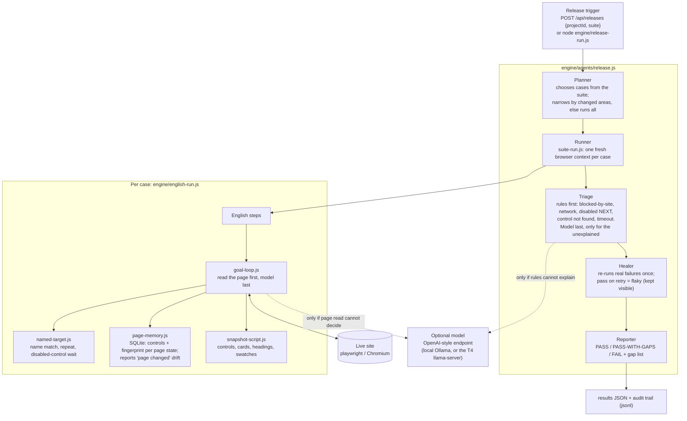

# Release-run agents and the web release path

One command or one API call runs a whole release against a live site, and says honestly what passed, what the site blocked, and what is really broken.

## The picture



## Agents and status

Every activity has its own agent, and each reports `waiting`, `working`, `done`, `skipped` or `failed` with a one-line message (shown live on `/releases`): Planner, Runner, Performance (one page load, timing warnings), Security (passive header and cookie check of the start page), Triage, Healer, Reporter. A Performance or Security check that cannot run is shown as `failed` for that agent and never stops the release. Their warnings appear as gaps and turn a PASS into PASS-WITH-GAPS.

## Everything is keyed by project ID

Suites live in `test-cases/projects/<projectId>/`. Releases, agent status, results and history are filed under the project ID; one release runs at a time per project.

| Call | What |
|---|---|
| `GET /api/projects/:projectId/suites` | suites of the project |
| `POST /api/releases` `{projectId, suite, changed?, heal?, perf?, security?}` | start a release, returns `releaseId` |
| `GET /api/releases?projectId=ID` | the project's releases, newest first (survives restarts) |
| `GET /api/releases/:id` | live agent status, progress, result |
| `GET /api/releases/:id/audit` | the audit trail |

The page is `/releases?project=<projectId>`. Set `PHOENIX_RELEASE_TOKEN` to require `Authorization: Bearer <token>` on every call.

## Verdicts (kept apart so a release verdict is honest)

| Verdict | Meaning |
|---|---|
| `passed` | every step did what it said |
| `blocked-by-site` | the live site stopped the journey (sold out, stock reserved, waitlist, out of stock). Not a Phoenix or test fault. Only applies on product and cart pages: a banner on a home or listing page never stops a journey |
| `not-run-network` | the machine lost its connection; re-run, it says nothing about the site |
| `failed` | a step could not be done: control missing, disabled, wrong |
| `flaky` | failed once, passed on the Healer's retry; shown in the report, never hidden |

Release verdict: `FAIL` if any case failed, `PASS-WITH-GAPS` if some were blocked, not run or flaky, else `PASS`. A pass means every step reached the right control; it does not yet prove the page ended in the right state (no "no error message is showing" check yet).

## Audit trail

Every agent action is appended to `$PHOENIX_DATA_DIR/release-runs/audit-<time>.jsonl` (planner chose these cases, triage said this about that case, healer retried these, reporter gave this verdict) and the same list is stored in the results file. Nothing is silent.

## Models

The agents work on rules alone. A model is optional and used last:

| Variable | Meaning |
|---|---|
| `PHOENIX_AGENT_LLM_URL` | OpenAI-style base URL: local Ollama `http://host.docker.internal:11434` from Docker on a Mac, or the GPU server's llama-server `http://<host>:8080`. Unset = rules only |
| `PHOENIX_AGENT_MODEL` | model name (`llama3`, `qwen3:8b`, `qwen3-8b`) |
| `PHOENIX_AGENT_LLM_KEY` | bearer key, sent only if set (use with llama-server `--api-key`) |

Prompts are short (2,000 characters), replies short (160 tokens), thinking off, one request at a time.

## Secrets for login cases

Test credentials never go in the repo. `scripts/encrypt-secret.js` prompts for a value (hidden) and prints `PHOENIX_TEST_<NAME>=enc:...`; paste that line into `.env`. The engine decrypts with `TESTOPS_SECRETS_KEY` only when a step needs `${NAME}`, and results mask secret values.

## Running it

```
docker compose up -d --build engine phoenix-api
docker compose exec -e PHOENIX_AGENT_LLM_URL=http://host.docker.internal:11434 -e PHOENIX_AGENT_MODEL=llama3 \
  engine node engine/release-run.js test-cases/projects/yes-my/release-web.json
```

Only the sandbox cannot reach yes.my; run it from a machine that can. `engine/suite-run.js` runs the same cases without the agents (no triage, no healing).

## Not built yet (stated plainly)

- authentication beyond the shared release token (real project login and roles)
- performance and security checks deeper than one page load and one header read (no load test, no scanner run inside a release)
- a "check that no error is showing" assertion step
- login journeys (the login location on yes.my is not yet known)
- mobile app agents (MyYes on BrowserStack or Appium)
- the yes.my suite itself needs refreshing: the live line-up has moved to iPhone 18 and Galaxy Fold 8, so the X500 and iPhone 17 cases are stale
