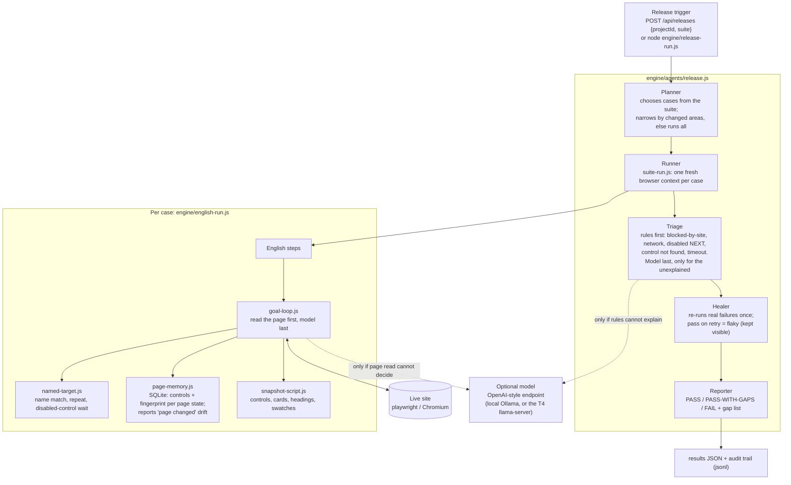

# Release-run agents and the web release path

One command or one API call runs a whole release against a live site, and says honestly what passed, what the site blocked, and what is really broken.

## The picture



## The named agent team (wired into the framework)

The agents are not a separate system. They are saved agents in the Phoenix backend (`backend/phoenix_api/agents.py`), one per pipeline stage group, defined in `prompts/agents-roster.json` and seeded on every API start (never overwriting an agent a person has edited or switched off). A tester calls one by name (`POST /api/agents/{name}/run`) and it runs through the same pipeline, gates, approvals and sign-off as everything else, under the tester's avatar. Each has an original logo in `prompts/agent-avatars/`, served at `/api/agents/{name}/avatar.svg` and shown on the Agents screen and on `/releases`.

| Agent | Stage(s) | Does |
|---|---|---|
| **Scout** | scenarios | proposes test scenarios from requirements |
| **Scribe** | cases | turns scenarios into English test cases |
| **Mint** | testdata | makes test data, asks only for what cannot be made up |
| **Runner** | execution | runs the cases on the target and retries real failures once |
| **Tracer** | har | captures network traffic of a run |
| **Pacer** | performance | times pages and runs load tests |
| **Warden** | secrets, sast, traceability | secrets, code flaws, requirements vs what is built |
| **Prowler** | dast | scans the running app with ZAP |
| **Judge** | aieval | scores AI answer quality |
| **Forge** | unittests, testspr | writes unit tests and opens the pull request |
| **Herald** | defects, signoff | explains failures, files Jira defects, asks for sign-off |
| **Mentor** | feedback | sends logs and results back to the AI |

On the release page the jobs map onto the team: Planner shows as Scribe, Runner and Healer as Runner, Performance as Pacer, Security as Warden, Triage and Reporter as Herald. Of these, only the web release path (Runner, Pacer, Warden, Herald's triage and report) is proven on live yes.my; the others run through the existing pipeline and are not re-verified here.

## Agents and status

Every activity has its own agent, and each reports `waiting`, `working`, `done`, `skipped` or `failed` with a one-line message (shown live on `/releases`): Planner, Runner, Performance (one page load, timing warnings), Security (passive header and cookie check of the start page), Triage, Healer, Reporter. A Performance or Security check that cannot run is shown as `failed` for that agent and never stops the release. Their warnings appear as gaps and turn a PASS into PASS-WITH-GAPS.

## Everything is keyed by project ID

Suites live in `test-cases/projects/<projectId>/`. Releases, agent status, results and history are filed under the project ID; one release runs at a time per project.

| Call | What |
|---|---|
| `GET /api/projects/:projectId/suites` | suites of the project |
| `POST /api/releases` `{projectId, suite, changed?, heal?, perf?, security?}` | start a release, returns `releaseId` |
| `GET /api/releases?projectId=ID` | the project's releases, newest first (survives restarts) |
| `GET /api/releases/:id` | live agent status, progress, result |
| `GET /api/releases/:id/audit` | the audit trail |

The page is `/releases?project=<projectId>`. Set `PHOENIX_RELEASE_TOKEN` to require `Authorization: Bearer <token>` on every call.

## Mobile apps in a release

A mobile suite is the same release with a different Runner. Put `"platform": "android"` or `"ios"` and the app in the suite:

```json
{ "name": "MyYes app", "platform": "android", "app": { "file": "myyes.apk" }, "provider": "browserstack", "device": "Samsung Galaxy S23", "osVersion": "14",
  "cases": [ { "id": "M-001", "title": "Log in screen opens", "steps": ["Tap Login", "Check that the page says Login"] } ] }
```

- **Upload the app to the project:** on `/releases` (Mobile apps card) or `POST /api/projects/:projectId/apps?name=myyes.apk` with the file as the raw body. Apps are stored per project; `GET /api/projects/:projectId/suites` lists them. Or set `"app": {"url": "bs://<hash>"}` for an app already on BrowserStack.
- **One fresh session per case.** The app is uploaded to BrowserStack once per release. Verdicts, Triage, the Healer, the Reporter, the audit trail and the page are the same as for web.
- **Performance and Security** are web-only and show `skipped` for a mobile suite.
- **Needs:** the Appium host (or BrowserStack credentials in `.env`) the engine already uses for mobile. This path is covered by tests with a fake device; it has not been run on a real device from a release yet.

## Verdicts (kept apart so a release verdict is honest)

| Verdict | Meaning |
|---|---|
| `passed` | every step did what it said |
| `blocked-by-site` | the live site stopped the journey (sold out, stock reserved, waitlist, out of stock). Not a Phoenix or test fault. Only applies on product and cart pages: a banner on a home or listing page never stops a journey |
| `not-run-network` | the machine lost its connection; re-run, it says nothing about the site |
| `failed` | a step could not be done: control missing, disabled, wrong |
| `flaky` | failed once, passed on the Healer's retry; shown in the report, never hidden |

Release verdict: `FAIL` if any case failed, `PASS-WITH-GAPS` if some were blocked, not run or flaky, else `PASS`. A pass means every step reached the right control. To prove the page also ended in the right state, end a journey with a check step: `Check that no error is showing`, `Check that the page says "Order summary"` or `Check that the URL contains /cart`. Check steps only read the page (no clicks, no model) and fail with the page's own words.

## Audit trail

Every agent action is appended to `$PHOENIX_DATA_DIR/release-runs/audit-<time>.jsonl` (planner chose these cases, triage said this about that case, healer retried these, reporter gave this verdict) and the same list is stored in the results file. Nothing is silent.

## Models

The agents work on rules alone. A model is optional and used last:

| Variable | Meaning |
|---|---|
| `PHOENIX_AGENT_LLM_URL` | OpenAI-style base URL: local Ollama `http://host.docker.internal:11434` from Docker on a Mac, or the GPU server's llama-server `http://<host>:8080`. Unset = rules only |
| `PHOENIX_AGENT_MODEL` | model name (`llama3`, `qwen3:8b`, `qwen3-8b`) |
| `PHOENIX_AGENT_LLM_KEY` | bearer key, sent only if set (use with llama-server `--api-key`) |

Prompts are short (2,000 characters), replies short (160 tokens), thinking off, one request at a time.

## Secrets for login cases

Test credentials never go in the repo. `scripts/encrypt-secret.js` prompts for a value (hidden) and prints `PHOENIX_TEST_<NAME>=enc:...`; paste that line into `.env`. The engine decrypts with `TESTOPS_SECRETS_KEY` only when a step needs `${NAME}`, and results mask secret values.

## The agents for logs, measurement and unit tests

- **mentor** keeps the logs (every pipeline stage is saved to the log store) and offers captured answers to a person for labelling; it never trains or promotes a model.
- **measure** (new, stage `measure`) computes defect leakage, unit-test leakage, detection percentage, the quality KPIs and the indicative TMMI level.
- **forge** now writes unit tests (Java, PHP, Python, JavaScript, TypeScript, Go, C#) from a requirement and the changed code, and runs unit and integration tests per language (stage `unitrun`). See docs/MEASUREMENT.md.

## Testing the agents

`bash scripts/test-agents.sh` runs only the agent tests (release agents, check steps, suite runner, release API, backend agents and avatars, MCP agent tools), kept apart from the rest of the suite. Each package's own `npm test` still runs everything.

**Integration tests** (`engine/test/integration/`, run by the same script; `--unit-only` skips them, or `cd engine && npm run test:integration`) drive every agent through a real Chromium against a local fake store (`fake-store.js`: product cards, sold-out, a one-off error page, a checkout that ends in an error, a slow page with weak headers). They cover pass / blocked-by-site / failed, check steps, the Healer turning a one-off failure into `flaky`, Performance and Security warnings, every agent ending `done`, the audit trail, and the project-keyed release API from one POST to the verdict and history. The model endpoint points at a closed port, so they prove the page-reading path needs no model. They found and fixed four real faults: short product cards had no card context, numbers in names ("24 Months") were ignored, a failed check or model error was mislabelled as a site block, and the Healer's retry reset the Runner's status.

## Running it

```
docker compose up -d --build engine phoenix-api
docker compose exec -e PHOENIX_AGENT_LLM_URL=http://host.docker.internal:11434 -e PHOENIX_AGENT_MODEL=llama3 \
  engine node engine/release-run.js test-cases/projects/yes-my/release-web.json
```

Only the sandbox cannot reach yes.my; run it from a machine that can. `engine/suite-run.js` runs the same cases without the agents (no triage, no healing).

## Not built yet (stated plainly)

- authentication beyond the shared release token (real project login and roles)
- performance and security checks deeper than one page load and one header read (no load test, no scanner run inside a release)
- login journeys (the login location on yes.my is not yet known)
- real project login and roles (today a shared release token)
- a real-device run of the mobile release path (built and tested with a fake device; needs your app and an Appium host or BrowserStack)
- the yes.my suite itself needs refreshing: the live line-up has moved to iPhone 18 and Galaxy Fold 8, so the X500 and iPhone 17 cases are stale
