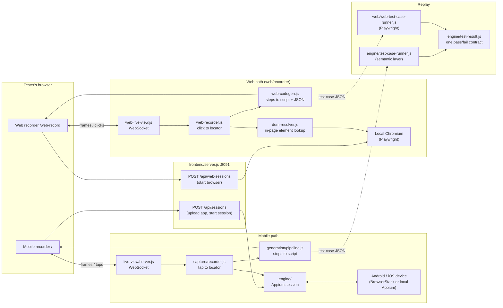
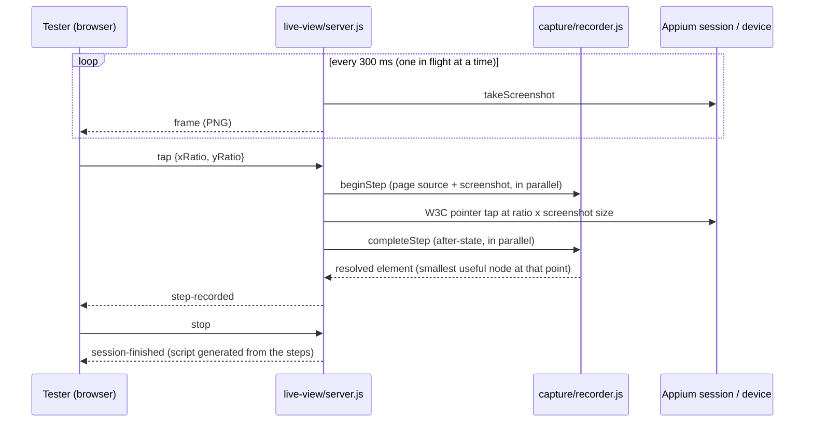
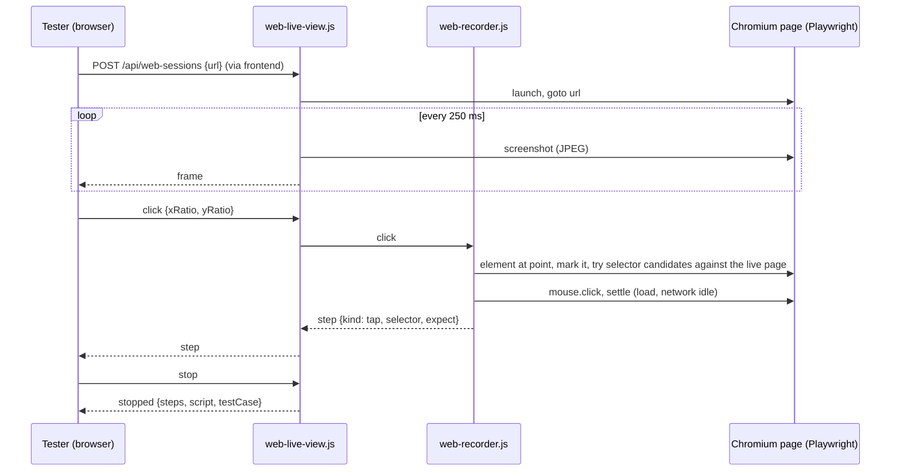
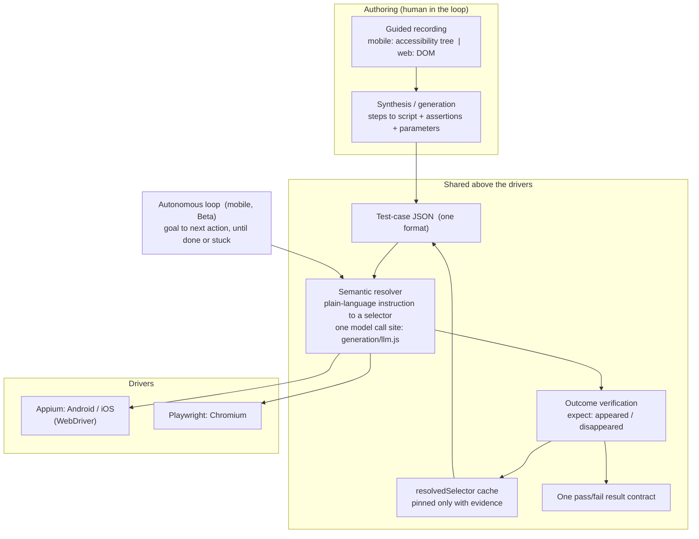

# Architecture — TestOps ai-automate

How the pieces fit together today. For the product spec and roadmap see
[`TESTOPS_MOBILE_SPEC.md`](TESTOPS_MOBILE_SPEC.md); for every bug, decision and
piece of evidence see [`STATUS.md`](STATUS.md). This page is the map.

TestOps ai-automate records a tester's manual run of an app (Android/iOS) or a
website and turns it into a runnable script plus a replayable test case. There
are two **recording surfaces** (mobile, web) that share one shape: a live
mirror in the tester's browser, a recorder that turns each action into a step,
and a generator that turns the steps into output. A third piece, the
**runners**, replays test-case JSON on either surface and reports through one
pass/fail contract.

## 1. System overview

The four AI layers (guided recording, semantic resolution, vision fusion,
autonomous loop) sit on the **mobile** path; see
[`diagrams/architecture.png`](diagrams/architecture.png). The web path is
deliberately deterministic: locators come from the page's own DOM, with no model
call while recording. The web runner can still fall back to the semantic
resolver (`generation/webview-act.js`) for a step that has an `instruction` but
no selector.

## 2. Mobile recording

- **Coordinates.** A tap ratio is a fraction of the screenshot the tester sees,
  so it is scaled by that screenshot's own pixel size (read from the PNG
  header), never by `getWindowSize()`. They differ on real devices (a Pixel 7
  screenshot is 1080x2400, its window 1080x2219) and using the window size made
  every tap land ~8% too high.
- **Actions are serialized.** One tap/scroll/type runs at a time, in order. An
  action that arrives while another is recording is refused with a `busy`
  message, and Stop waits for the in-flight action; nothing runs after Stop.
  A BrowserStack step takes 10-15 s, so without this the actions piled up.
- **Taps and scrolls use W3C `performActions`.** `mobile: clickGesture` is
  rejected by BrowserStack Android, and `DELETE /actions` 404s, so it is not
  called.
- **Element resolution** (`resolveElementAtCoordinate`): the smallest node
  containing the point; climbs to a "useful" ancestor when the tap landed on a
  bare wrapper (capped at half the largest area so it never resolves to the app
  root); a screen-sized unnamed container (an accessibility-less keypad) becomes
  a coordinate step, replayed by ratio.
- **Locator priority:** resource-id > accessibility-id > text > xpath >
  coordinate.
- **Generation** (`generation/pipeline.js`): consecutive taps on one named
  element collapse; assertions come from labels that appeared after a step,
  never from error messages, edit-field contents, masked values or what the
  tester typed; a label that exists only as a content-desc is asserted with
  `.description()`; typed values become parameters; the flow is named from a text
  label.

## 3. Web recording

- **Messages (client to server):** `navigate`, `click`, `type`, `press`,
  `select`, `scroll`, `stop`. **Server to client:** `ready`, `frame`, `page`,
  `step`, `select-options`, `error`, `busy`, `stopped`.
- **Viewport** is a fixed 1280x800, so click ratios map directly to CSS pixels.
- **Locator choice** (`dom-resolver.js` + `WebRecorder._resolveSelector`).
  Candidates, best first: `data-testid` > role+name (exact, then substring) >
  label > id > name/placeholder > text > css path. Each is tested against the
  live page: the first that matches exactly one element wins; a non-unique
  semantic locator is pinned with `nth` rather than silently hitting its twin;
  the positional css path is used only when nothing semantic matched. Names use
  the first line of the element's text, because a container's text joins its
  children with newlines and would never match on replay.
- **Native `<select>`.** The browser draws a dropdown's popup outside the page,
  so it never shows in the mirror. The recorder does not click it: it returns
  the option list (`select-options`), the UI draws a picker over the mirror, and
  the choice is recorded as a `select` step (`selectOption({ label })`).
- **Typing** replaces the field's value (never appends) and folds the click that
  focused the field into the `type` step. **Enter** records a `press` step.
- **Output** (`web-codegen.js`): a standalone `@playwright/test` script and a
  test-case JSON. Scroll steps and repeated clicks on one element are dropped
  (Playwright scrolls into view itself). The flow is named from the site host.
- **Assertions** are the text that appeared after a step, filtered to stable
  copy: no prices, clocks, addresses (long digit runs, several commas), FAQ
  questions (`?`), fragments of wrapped headings, short words or typed values;
  at most three per step, longest first. After a click the recorder waits for
  the page to load and for the network to go idle, so results fetched by XHR
  are captured.
- **Where it runs.** On a machine with Chromium (`npx playwright install
  chromium`, or `TESTOPS_MOBILE_WEB_CHROMIUM_PATH`). The Docker image does not
  contain a browser.

## 4. Test-case JSON and runners

One format, three platforms (`android | ios | web`), one result shape
(`engine/test-result.js`).

| Step kind | Web | Fields |
|---|---|---|
| `navigate` | yes | `url` (relative URLs join `baseUrl`) |
| `tap` | yes | `selector` or `instruction`; optional `expect` |
| `type` | yes | `selector`/`instruction`, `text` (`${ENV}` placeholders supported) |
| `select` | yes | `selector`/`instruction`, `option` (visible label) |
| `press` | yes | `key`, optional `selector` |
| `scroll` | yes | `direction` |
| `wait` | yes | `durationMs` |
| `tapIfExists` | yes | `selector` (skipped if absent) |
| `assert` | yes | `assert: {urlContains, titleContains, textVisible[], textHidden[]}` |

Web selector strategies: `css | xpath | text | label | testid | role`
(`role` carries `role`, `value` = accessible name, optional `exact`); any
strategy may carry `nth`. Any tap/type/select/press step may carry
`expect: {appeared[], disappeared[]}`, checked against the text that actually
appeared or disappeared. The web runner waits up to 10 s for an element to
exist before failing "element not found".

`node web/run-web-test-case.js <file>.json [--base-url URL] [--headed]
[--persist]` replays a web case and exits 0 on pass. Mobile cases run through
`run-batch-executions.js` in `test-case` mode (see
[`REAL_DEVICE_BATCH_TESTING.md`](REAL_DEVICE_BATCH_TESTING.md)).

## 5. How Appium, Playwright and the AI layers fit together

They are not merged into one engine. **Appium** drives mobile apps and
**Playwright** drives the browser, and each stays behind its own adapter. What is
shared is everything above the driver: one step format, one resolver contract,
one way to verify an outcome, one result shape, one place the AI is called.

**What is literally the same code on both sides**
- **The DOM snapshot and resolver** (`generation/webview-snapshot.js`,
  `generation/webview-act.js`). On the web it runs through Playwright's
  `page.evaluate`; for a hybrid app's WebView it runs through Appium's
  `driver.execute` inside the WebView context. Same ref-indexed snapshot, same
  "pick one or say unresolved, never guess" contract, two transports.
- **The test-case JSON, `${ENV}` placeholders, `expect` checks
  (`generation/outcome-verification.js`) and the result contract
  (`engine/test-result.js`).** The web runner imports these from the mobile side
  rather than copying them.
- **The model call site.** `generation/llm.js` is the only place any layer talks
  to a model (a self-hosted Ollama), so swapping or retraining the model is a
  config change.

**The layers, and where each one runs today**

| Layer | Mobile (Appium) | Web (Playwright) |
|---|---|---|
| Guided recording | Accessibility tree + screenshots; locator priority resource-id > a11y-id > text > xpath > coordinate | DOM; data-testid > role+name > label > id > text > css path, verified against the live page |
| Synthesis (script generation) | `generation/pipeline.js`: WebdriverIO script, assertions from the diff, typed values lifted to parameters | `web/recorder/web-codegen.js`: Playwright script + test-case JSON, same assertion rules |
| Semantic resolution | `generation/semantic-act.js` over the accessibility snapshot; WebView DOM tried first when one exists | `generation/webview-act.js` over the DOM, used by the runner for steps that have an `instruction` but no selector |
| Vision fusion | Screenshot sent with the element list (opt-in) | Not built |
| Autonomous loop | `engine/semantic-loop.js` (Beta) | Not built |
| Self-heal | Live retry on "No visible change", `engine/auto-heal.js`, confidence-gated locator store | Pins a proven `resolvedSelector` back into the file; no live retry yet |
| Outcome verification | Yes | Yes |

**How guided execution and the loop relate.** Guided and semantic are one
pipeline, not alternatives. A tester records a flow once (guided); the result is
a test case whose steps can carry an instruction, a selector, or both. At run
time each step replays its cached selector deterministically, falls back to
semantic resolution when it misses, checks its `expect`, and pins the new answer
only with evidence. The autonomous loop is the exploration mode on top: given a
goal instead of a step list it asks the model for one action at a time through
the same executor, and stops when the goal is reached, the model asks to stop,
an action fails, or it repeats an action that does nothing. A flow whose steps
can be written down belongs in test-case mode; the loop is for discovery.

**Honest status.** Fusion is at the contract level (shared format, resolver,
verification, result), not a single merged runtime. The vision and loop layers
are mobile-only so far; bringing semantic self-heal and the loop to the web
runner is the natural next step.

## 5b. The layers as one ladder (Guided, Synthetic, Semantic, AI)

The recorder page is one page for both platforms; the web live view speaks the mobile live-view
protocol, so the same stage, steps panel and guided cards drive either. Beneath it, how a step is
done is a ladder: Synthetic (recorded locator) falls to Semantic (instruction to element, with vision),
then AI (goal loop), then Guided (a person); every rescue proposes a patch that promotes the fix
back up into the Synthetic layer, gated on evidence. Semantic, AI and the ladder are written once
against `engine/core/surface.js`; `web/surface/` is the Playwright adapter and an Appium adapter is
the planned second one. `api` steps (`engine/core/api-step.js`) work in any flow. Full description:
[`LAYERS.md`](LAYERS.md). Engine upgrades: [`UPGRADING.md`](UPGRADING.md).

## 6. Key design decisions

| Decision | Why |
|---|---|
| Guided recording first, autonomous later | A human handles the judgment calls (OTP, payment); an agent that guesses wrong there costs more than it saves. |
| One recorder shape, two surfaces | Mirror, recorder, generator is the same loop for mobile and web, so testers learn it once and TestOps integrates it once. |
| Scale taps by the screenshot's size | `getWindowSize()` omits system bars; found on a real BrowserStack run. |
| Serialize actions, refuse overlap | BrowserStack calls are slow; overlapping actions raced with Stop and the HTTP client. |
| Web locators verified against the live page | A text locator that matches several elements clicks the wrong one on replay; check at record time, pin with `nth`. |
| Deterministic web recording (no model) | The DOM already has stable names; a model call adds latency and nondeterminism. |
| Drop scrolls and repeated clicks from web output | Playwright scrolls into view itself; repeats are testers poking at a control. |
| Assert only stable copy | Prices, addresses and FAQ text change without the feature breaking; a brittle assertion is worse than none. |
| Local Chromium for the web recorder | No device cost or latency; the recorder needs a real browser, which the Docker image deliberately omits. |
| One result contract | TestOps shows one pass/fail shape whatever the platform. |

## 7. Deployment

- **Tester machine / dev server:** `node frontend/server.js` serves both
  recorders on `:8091`. The mobile path needs Appium (local host or
  BrowserStack, see [`SETUP.md`](SETUP.md)); the web path needs Chromium.
- **Docker** ([`TESTOPS_MOBILE_DOCKER.md`](TESTOPS_MOBILE_DOCKER.md)): the Node
  services (live view, recorder, generator, frontend, runners). No emulator, no
  Appium, no Chromium.
- **TestOps integration:** the test-case JSON and result contract are the
  integration surface
  ([`TESTOPS_INTEGRATION_GUIDE.md`](TESTOPS_INTEGRATION_GUIDE.md)); the MCP
  connector (`mcp/`) exposes locator history, test cases and the execution log.

## 8. Known gaps

- Web: file uploads, iframes and new-tab flows are not recorded; icon-only
  elements with no readable name fall back to a positional css path.
- Mobile: a recorded Android script has not yet been replayed on BrowserStack to
  confirm pass/fail; BrowserStack latency makes recording slow (local emulator
  recording is the proposed fix); Flutter UIs are not identifiable.
- TestOps write API and frothAI contract are not built.

See also: [RUN_TARGETS.md](RUN_TARGETS.md) for where a recording or run happens (Local or BrowserStack) and how it is reported.
