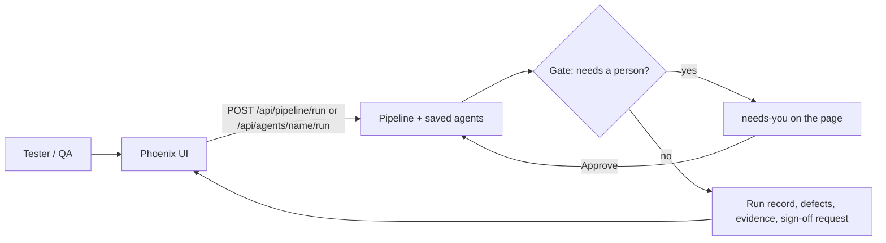
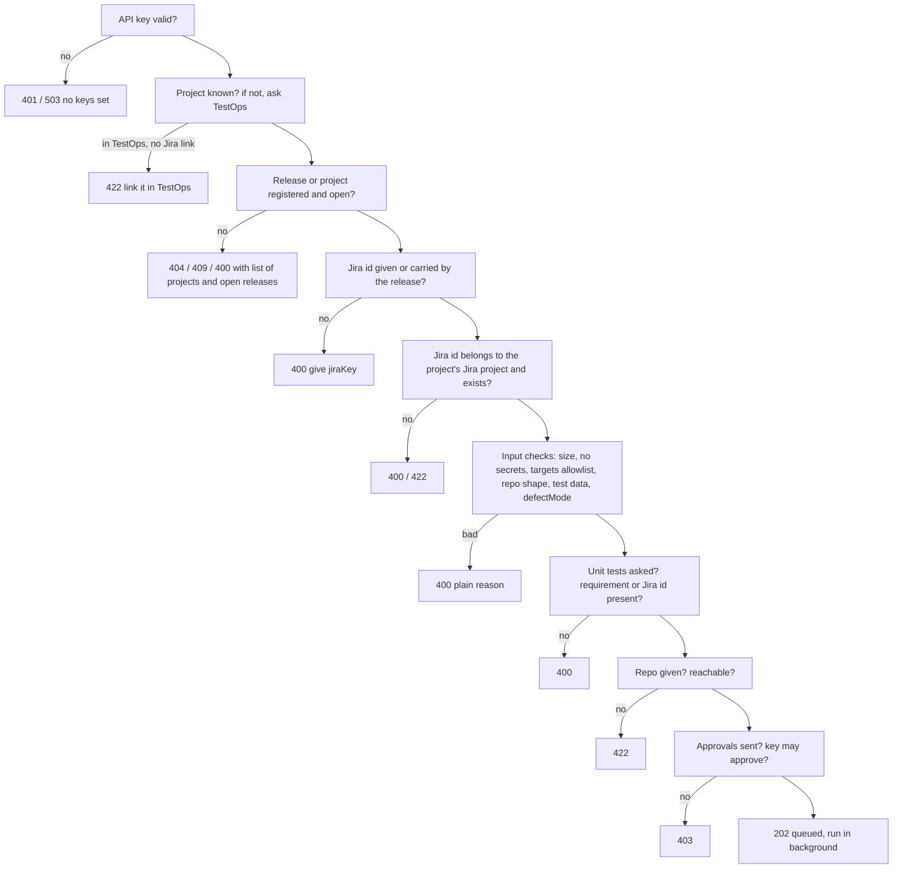

# Workflows: UI, API, every combination, and what changes in TestOps

Three ways in, one engine. Everything below runs through the same saved agents, the same pipeline, the same gates and the same sign-off. Nothing here is a second system.

| Way in | Who | Identity | Approves gated steps by |
|---|---|---|---|
| **Phoenix UI** (web-ui pages) | Tester, QA lead, Head of QA | `X-User` (SSO proxy in front; no real login yet) | clicking Approve on the page |
| **Release API** (`/api/v1/...`) | ILMU Code, CI, any agent | API key (hash on server) | only a key written `name:<hash>:approve`; the AI key cannot approve itself |
| **TestOps** (FrothTestOps) | Testers in the existing product | TestOps login | unchanged; it calls Phoenix with a key like any caller |

## 1. UI flows (what exists today)

| Flow | Pages | What happens |
|---|---|---|
| Plan and run a release | `/start` -> `/journey/:id` -> `/runs/:id` | Pick goal and requirement, the pipeline runs stage by stage, `needs-you` stages wait on the page, result and audit on `/runs/:id` |
| Cases and sign-off | `/cases`, `/signoff`, `/guided/:runId/:caseId` | Cases from the case library, request and decide sign-off (four eyes), replay a guided case |
| Run a saved agent | `/agents` (`POST /api/agents/{name}/run`) | One named agent (scout, scribe, mint, forge, runner...) or a chain; runs under the tester's avatar (`/avatar`) |
| Unit tests | `/unit-tests` | Pick repo, AI writes tests from requirement and changes, review, open PR |
| Code, security, performance, defects, AI eval | `/code`, `/security`, `/performance`, `/defects`, `/eval` | Semgrep and secrets, ZAP, Locust, Jira defects, DeepEval |
| Intranet or VPN apps | `/runners`, `/live` ("My laptop") | Pair a laptop runner, drive the tester's own browser through the hub |
| Industry products | `/plugins` | SAP, Salesforce, Dynamics 365, SuiteCRM, OTOBO, OTRS, Odoo plugins |
| Quality view | `/dashboard`, `/quality`, `/logs`, `/gateway` | KPIs, TMMI view, logs, model-call gateway |
| Settings | `/notifications` | Encrypted settings, admin only |



## 2. API flows

All calls need `Authorization: Bearer <key>`.

| Call | Purpose |
|---|---|
| `GET /api/v1/actions` | agents and their actions |
| `POST /api/v1/events` | send an event: agent + action, or `steps`, or `team` + `release` |
| `GET /api/v1/events/{id}` | status per agent |
| `GET /api/v1/events/{id}/artifacts` | created scenarios, cases, field names, unit tests, unit cases (with Jira keys), PR, flags |
| `POST /api/v1/events/{id}/approve` | approving key only |
| `GET/POST /api/registry/projects`, `/api/registry/releases` | Head of QA creates releases; projects link to Jira |

### Order of checks on `POST /api/v1/events` (each failure says what to do)



### Run, approve, callback

```mermaid
sequenceDiagram
  participant C as Caller (ILMU Code)
  participant P as Phoenix
  participant A as Agents
  participant J as Jira
  C->>P: POST /api/v1/events
  P-->>C: 202 {id, statusUrl}
  P->>A: each agent in order (scenarios handed on)
  A->>A: output checks (redact, cap, flag)
  alt a gated step (live DAST, production)
    A-->>P: needs-you
    P-->>C: callback status needs-you
    C->>P: POST /approve (approving key)
    P->>A: resume
  end
  A->>J: one bug for all findings; unit tests: TestOps case, then Jira test issue
  P-->>C: signed callback + GET /artifacts
```

## 3. Permutations

### 3.1 Who calls, and how much

| # | Caller | Scope | Example | Result |
|---|---|---|---|---|
| 1 | AI key | one agent, one action | `forge` + `write-unit-tests` | only the `unittests` stage runs |
| 2 | AI key | one agent, all stages | `warden` + `run` | secrets, sast, traceability, revalidate |
| 3 | AI key | several agents, caller's order | `steps: [scout, scribe, forge]` | up to 13, no repeats; scenarios handed on |
| 4 | AI key | the whole team | `team` + `release` | scout, scribe, mint, forge, runner, tracer, pacer, warden, prowler, judge, herald, mentor, measure |
| 5 | AI key | both checks | `warden` + `scan` | `secrets` (Gitleaks) and `sast` (Semgrep) together |
| 6 | AI key | live security | `prowler` + `dast` | stops at `needs-you` until an approving key approves |
| 7 | Approving key | any of the above + `approvals` | `{"dast": true}` | runs; `approvedBy` recorded |
| 8 | UI user | agent from `/agents` | same agents | same gates, approve on the page |

### 3.2 Identity: release, project, TestOps

| # | Sends | Registry state | Result |
|---|---|---|---|
| 9 | `release: R1` | registered, open | project comes with the release |
| 10 | `project: Shop` (name or id) | registered | accepted; release stays empty |
| 11 | `project: Loyalty` | only in TestOps, has Jira link | copied into Phoenix, then accepted |
| 12 | `project: Loyalty` | in TestOps, no Jira link | 422: link it in TestOps first |
| 13 | neither | any | 400 with projects and open releases listed |
| 14 | `release: OLD` | closed | 409; Head of QA can reopen |
| 15 | `release` and `project` that do not match | any | 400 |
| 16 | `release: MADE-UP` | not registered | 404; ask Head of QA to create it |

### 3.3 Jira

| # | Sends | Result |
|---|---|---|
| 17 | `jiraKey: SHP-5`, Jira connected, exists | accepted |
| 18 | `jiraKey: PAY-5` on project SHP | 400, wrong Jira project |
| 19 | `jiraKey: SHP-404` that does not exist | 422 |
| 20 | no `jiraKey`, release carries `SHP-12` | accepted, uses `SHP-12` (also stands in for the requirement) |
| 21 | no `jiraKey`, nothing carried | 400 give `jiraKey` (rule off with `PHOENIX_API_REQUIRE_JIRA=false`) |
| 22 | Jira not connected on the server | accepted; bug and Jira-push steps report `unavailable`, never pass |

### 3.4 Repo, requirement, unit tests

| # | Sends | Result |
|---|---|---|
| 23 | `repo` reachable + requirement + `base`/`head` | AI writes tests for the changed files only |
| 24 | `repo` reachable, no `base`/`head` | up to 5 source files, Semgrep-flagged first |
| 25 | `repo` unreachable | 422 with the reason |
| 26 | no `repo`, scans asked | `secrets` and `sast` say "no code repo linked"; the server's own folder is never scanned |
| 27 | unit tests asked, no requirement, no Jira id | 400 |
| 28 | `run-unit-tests` | runs only in `PHOENIX_UNIT_ROOT` or clones from `PHOENIX_UNIT_CLONE_HOSTS`; otherwise `unavailable` |
| 29 | `open-tests-pr` | tests go out as a PR for a person to review |

### 3.5 Targets and data

| # | Sends | Result |
|---|---|---|
| 30 | `appUrl` on `PHOENIX_API_TARGETS` | accepted |
| 31 | `appUrl` off the list, or no list set | 400 |
| 32 | secret in requirement or task | 400, credentials go in `testData` |
| 33 | `testData` over 50 pairs or nested values | 400 |
| 34 | `production: true` | 400, never from the API |
| 35 | prompt-injection text in the requirement | accepted as data, listed in `warnings` |

### 3.6 Bugs and outputs

| # | Setting | Result |
|---|---|---|
| 36 | default (`defectMode: single`) | one bug per release for everything found; next run comments on it |
| 37 | `defectMode: each` | one bug per finding; a repeat comments on its open bug |
| 38 | `PHOENIX_API_AUTO_DEFECTS=false` | bugs wait for an approving key |
| 39 | unit tests, approved | TestOps case first, then Jira test issue linked to the requirement; not pushed twice |
| 40 | unit tests, not approved | kept in TestOps only; the result says pushing needs approval |
| 41 | generated code holds a secret or an address off the allowlist | secret redacted, address flagged in `flags` |

### 3.7 Where it runs

| # | Setup | Result |
|---|---|---|
| 42 | cloud execution | the engine runs the cases |
| 43 | intranet or VPN app | pair a laptop runner; live sessions and web test cases only |
| 44 | server restarts mid-run | event shows `interrupted`; send again |

## 4. Reuse of TestOps flows and level of change

TestOps modules are taken from the TestOps user guide (see `docs/PIPELINE.md`). "Level" is an estimate of the work, not a measurement.

| TestOps flow | Phoenix equivalent | Reuse | Change needed | Level |
|---|---|---|---|---|
| Projects and Jira link | `registry.py` (projects, `jiraProjectKey`), TestOps sync | Reuse TestOps as the source of truth for projects | Confirm TestOps project API fields (`id`, `name`, Jira key) and give Phoenix a service token; today the field names are assumed | Small |
| Release / cycle | Registered release number (Head of QA) | Likely maps to a TestOps test cycle; unknown | Decide: create releases in TestOps and sync, or keep them in Phoenix. TestOps would need a release API | Medium |
| Requirement and Jira integration | `jira.py`, `jiraKey` rule, requirement read | Reuse Jira connection settings | Per-project Jira project key; nothing else | Small |
| Test management (scenarios, cases) | case library (`signoff.TestCase`), scenarios and cases stages | Same ideas, separate store | Unit-test cases are created in Phoenix's library; writing them into TestOps' own tables needs a TestOps write API | Medium |
| Test automation (record and play) | recorders, English run, `execution` stage | Reuse as is | None for API runs; laptop runner for intranet | None / Small |
| API testing | `apitests`, negative cases | Reuse | None | None |
| Performance lab | `performance` (Locust) | Reuse | None | None |
| Security lab | `dast` (ZAP), always asks | Reuse | None | None |
| Code analyzer (SAST, secrets) | `sast`, `secrets` on a temporary copy of the repo | Reuse | Needs Semgrep and Gitleaks installed or container mode | Small |
| Defect management | `defects` stage, one bug for all | Reuse Jira defect type and labels | Add unit tests, Semgrep, secrets, DAST as sources (done); real Jira run still to prove | Small |
| FrothAI | planner and reviewer | Reuse the model endpoint | None | None |
| BrowserStack | run targets | Reuse | None | None |
| Roles and login | `X-User` header, API keys, `PHOENIX_QA_HEADS` | TestOps roles are the right source | Real login and role lookup (Head of QA from TestOps roles) | Large |
| Notifications | `/notifications`, digests | Reuse | None | None |
| Chrome extension (TestOps Recorder) | Phoenix Runner tab kit | Add a third tab | Two scripts and a manifest merge in the FrothTestOps extension repo | Small |

### Summary of the changes needed on the TestOps side

1. **Small:** a read-only project list with the Jira key and a token Phoenix can use; add the Runner tab to the recorder extension; call `POST /api/v1/events` where TestOps wants to start Phoenix work.
2. **Medium:** decide who owns release numbers (TestOps cycles or Phoenix), and a write path if unit-test cases must land in TestOps' own tables.
3. **Large:** real login and roles, so the Head of QA comes from TestOps instead of a list in the environment, and `X-User` stops being trusted.

## 5. What is proven and what is not

- Proven here with fakes: the event API, the registry, Jira rules, the checks, one bug for all, unit-test cases then Jira push, the scans on a temporary copy, the runner and the extension in real Chromium. Backend tests pass.
- Not proven: a real ILMU Code call, a real Jira, real GitHub or GitLab, Semgrep and Gitleaks installed, the TestOps project API (field names are assumed), a customer system, the Mac and Windows installers on real machines.
- Known gaps: no real login; events run inside the API process (a restart interrupts them); progress is per agent, not per stage; the pipeline's English `execution` stage does not run on a laptop; SAP is read-only and Odoo readback is not built.
